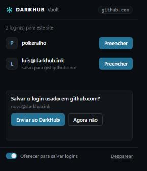
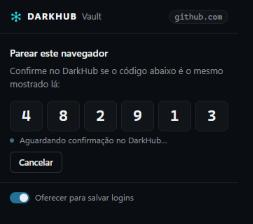

<p align="center">
  
</p>

<h1 align="center">DarkHub Vault para navegadores</h1>

<p align="center">
  Preenche e salva logins do cofre de senhas do <a href="https://github.com/Pokeralho/darkhub-suite">DarkHub Suite</a>.<br/>
  Só local: nunca fala com a internet, apenas com o app DarkHub rodando no seu PC.
</p>

<p align="center">
  <a href="https://github.com/Pokeralho/darkhub-vault-extension/releases/latest"></a>
  <a href="https://github.com/Pokeralho/darkhub-vault-extension/actions/workflows/ci.yml"></a>
  <a href="./LICENSE"></a>
  
</p>

<p align="center">
  <a href="./README.md">English</a> · <b>Português</b>
</p>

<p align="center">
  
  &nbsp;
  
</p>

---

## Como funciona

Extensão Manifest V3 para Chrome, Edge e Firefox (115+). Ela fala com o app DarkHub aberto por **native messaging**;
não há servidor, conta nem sincronização.

```
extensão ──connectNative("com.darkhub.vault")──> DarkHub.VaultBridgeHost.exe ──TCP 127.0.0.1 (handshake HMAC)──> app DarkHub
```

Você precisa do [DarkHub Suite](https://github.com/Pokeralho/darkhub-suite/releases/latest) 0.7.3 ou mais novo no
Windows 10/11. O app também traz esta extensão: **Cofre de senhas → Extensão do navegador → Abrir pasta da extensão**.

## Instalação

### 1. Registre o host nativo (no DarkHub)

Abra o DarkHub Suite → **Cofre de senhas** (desbloqueie) → **Extensão do navegador** → clique em **Registrar** para cada
navegador. Isso grava, só para o usuário atual do Windows, a chave
`HKCU\Software\<Google\Chrome | Microsoft\Edge | Mozilla>\NativeMessagingHosts\com.darkhub.vault` e os arquivos do host
em `%APPDATA%\<pasta do DarkHub>\vault-bridge\`. O manifesto do host libera **só** esta extensão
(`chrome-extension://dpibeiimcolhiofphhncmjbejgcfblgh/` e `vault@darkhub.app`). Detalhes no [README em inglês](./README.md#1-register-the-native-host-in-darkhub).

### 2. Carregue a extensão

Baixe o `darkhub-vault-x.y.z.zip` na [última versão](https://github.com/Pokeralho/darkhub-vault-extension/releases/latest)
e extraia, ou clone este repositório e use a pasta [extension/](./extension).

**Chrome / Edge**
1. Abra `chrome://extensions` (ou `edge://extensions`) e ligue o **Modo do desenvolvedor**.
2. **Carregar sem compactação** → escolha a pasta extraída.
3. O ID tem que ser `dpibeiimcolhiofphhncmjbejgcfblgh` (fixado pelo campo `key` do `manifest.json`); se for outro, o
   navegador recusa o host.

**Firefox**
1. Abra `about:debugging#/runtime/this-firefox` → **Carregar extensão temporária…** → escolha o `manifest.json`.
2. Em `about:addons` → DarkHub Vault → **Permissões**, permita o acesso a todos os sites (no Firefox as permissões de
   site do MV3 são opcionais); sem isso o ícone nos campos não aparece.
3. Extensões temporárias somem quando o Firefox fecha. Uma instalação permanente precisa da assinatura da Mozilla.

### 3. Pareie

Clique no ícone da extensão → **Parear com o DarkHub**. O popup mostra um código de 6 dígitos e o DarkHub mostra outro:
aceite só se forem iguais. Os navegadores pareados ficam listados no DarkHub e podem ser revogados lá; a extensão também
pode se desparear.

## Uso

- **Popup**: lista os logins salvos para o site da aba atual, cada um com o botão **Preencher**.
- **Ícone no campo**: ao focar um campo de usuário ou senha aparece um pequeno ícone do DarkHub; clique para escolher o login.
- **Salvar**: depois que você entra num site, o ícone da barra ganha um `+`; abra o popup e clique em **Enviar ao
  DarkHub**. O DarkHub pede confirmação antes de salvar (desligue "Oferecer para salvar logins" para não ver isso).

## Segurança

- Nada é respondido com o cofre bloqueado. Ele também bloqueia na tela de bloqueio do Windows e na suspensão.
- O app nunca envia o cofre: uma consulta devolve só os nomes de usuário do site da página. A senha de um login só sai
  num preenchimento explícito (clique real), depois que o app confere de novo o endereço informado pelo navegador (não
  pela página). A extensão só preenche se a resposta for da mesma origem da página.
- Páginas `http://` só recebem logins salvos explicitamente como `http://`; frames só recebem logins quando são do
  mesmo site da página principal.
- O ícone e o menu ficam numa shadow root fechada, que a página não consegue ler.
- Há limite de pedidos por navegador pareado, e o elo host↔app é TCP só em `127.0.0.1`, autenticado nos dois sentidos
  com HMAC-SHA256.

Encontrou um problema? Veja o [SECURITY.md](./.github/SECURITY.md).

## Desenvolvimento

Não há etapa de build: os arquivos de [extension/](./extension) são carregados como estão.

```bash
node scripts/check.mjs      # sintaxe, manifesto e paridade dos textos pt/en (o mesmo que o CI roda)
```

## Como contribuir

Relatos de bugs, traduções e pull requests são bem-vindos: leia o [CONTRIBUTING.md](./.github/CONTRIBUTING.md).

## Licença

[MIT](./LICENSE)
